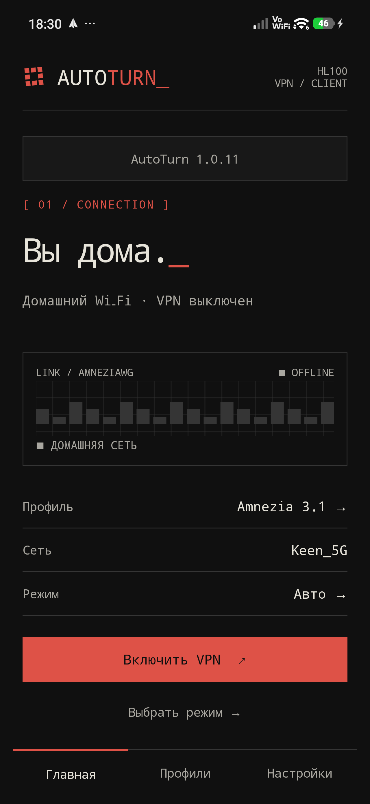
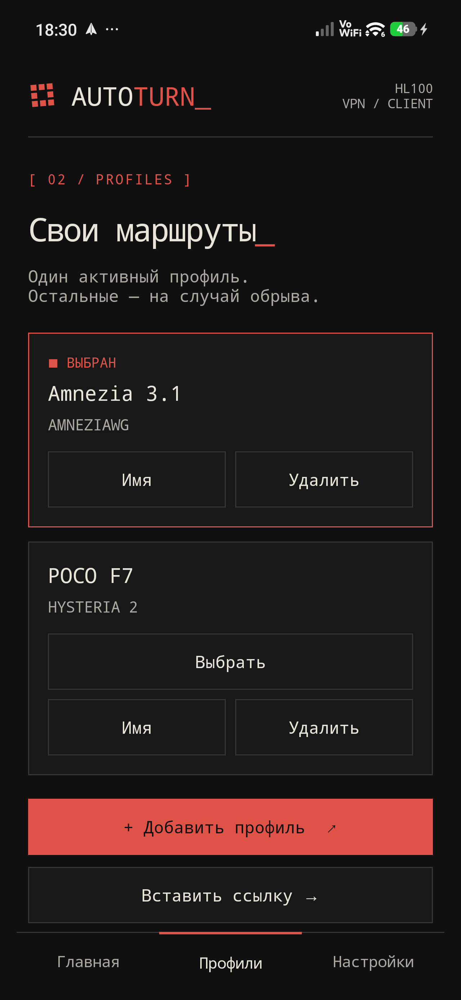
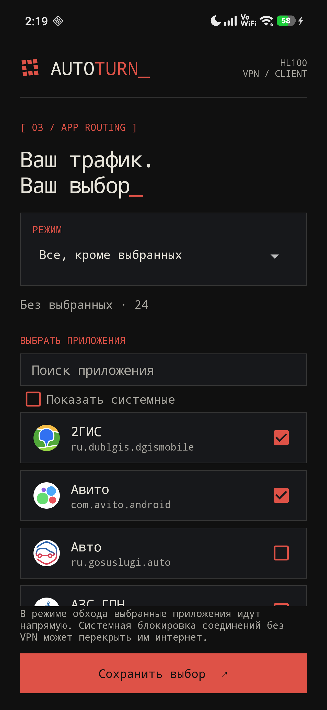

# AUTOTURN_

### Дома — напрямую. Вне дома — VPN.

Android-клиент, который переключает VPN по домашнему Wi-Fi.
Ваш сервер, ваши приложения, ручное управление в любой момент.

**[Скачать APK](https://github.com/cveloy102/autoturn-vpn/releases/latest)** · **[Инструкция со скриншотами](docs/usage.md)** · **[История версий](CHANGELOG.md)** · **[Сообщить об ошибке](https://github.com/cveloy102/autoturn-vpn/issues/new/choose)**

<table><tr>
<td align="center"> Подключение</td>
<td align="center"> Ваши профили</td>
<td align="center"> Ваши приложения</td>
</tr></table>

*AutoTurn 1.0.11 на POCO F7. Скриншоты сняты 12 октября 2026 года.*

## Что умеет AutoTurn

- **Переключает VPN по Wi-Fi:** дома выключает, в другой сети включает.
- **Работает с вашими профилями:** AmneziaWG, VLESS + REALITY и Hysteria 2.
- **Даёт ручной контроль:** включение и выключение в приложении или плиткой в шторке.
- **Возвращает в Авто:** через 2, 4, 6 или 24 часа после ручной команды.
- **Выбирает приложения для VPN:** все, только выбранные или все, кроме выбранных.
- **Использует резерв:** проверяет доступ через VPN и меняет профиль при сбое.

Доступны тёмная, светлая и системная темы. Обновления устанавливаются из GitHub Releases с подтверждением Android и сохранением профилей.

## Начало работы

1. [Скачайте APK](https://github.com/cveloy102/autoturn-vpn/releases/latest) из раздела **Assets** последнего релиза и установите на телефон.
2. В **Профилях** добавьте файл конфигурации или вставьте ссылку подключения.
3. Подключитесь к домашнему Wi-Fi и в **Настройках** нажмите **«Выбрать текущую сеть»**.
4. Выберите **«Авто»**, разрешите точное местоположение и доступ **«Всегда»** для определения Wi-Fi в фоне, подтвердите системный запрос VPN.

**Android 10+.** Проверено на POCO F7 с Android 16 / HyperOS. Для работы нужен ваш VPN-сервер или выданный вам профиль; сервер и подписка в приложение не входят.

[Пошаговая инструкция со скриншотами →](docs/usage.md)

## Помощь и документация

[Инструкция и FAQ](docs/usage.md) · [Данные и разрешения](docs/PRIVACY.md) · [Сообщить об ошибке](https://github.com/cveloy102/autoturn-vpn/issues/new/choose)

Android поддерживает одно активное VPN-подключение. Для фоновой работы на HyperOS могут потребоваться автозапуск и снятие ограничений батареи. [Решение частых проблем](docs/usage.md#faq).

Для разработчиков: [сборка и выпуск](docs/DEVELOPMENT.md) · [участие в проекте](CONTRIBUTING.md) · [безопасность](SECURITY.md).

[AutoTurn для macOS](https://github.com/cveloy102/autoturn-macos)
