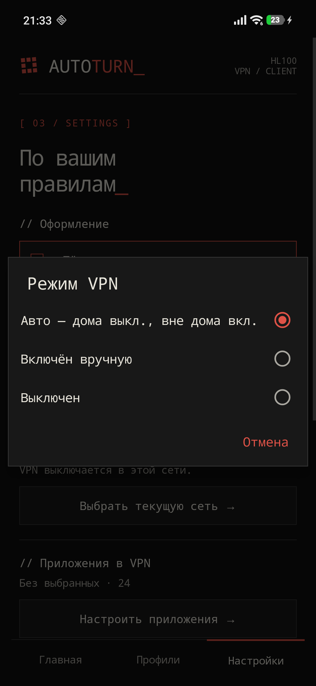
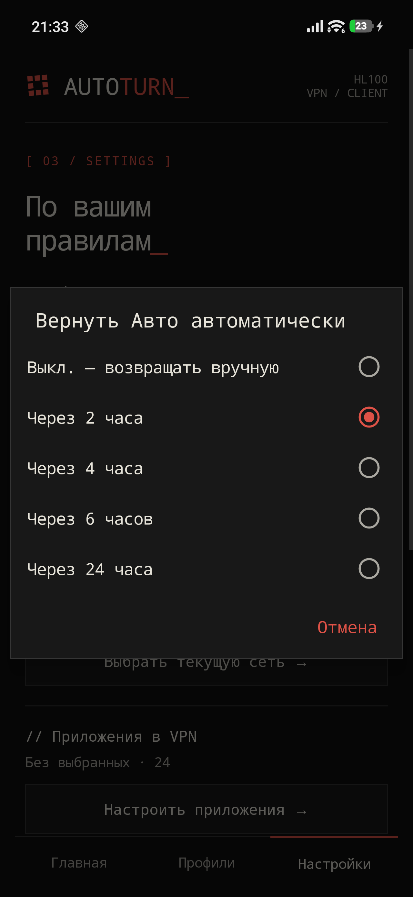
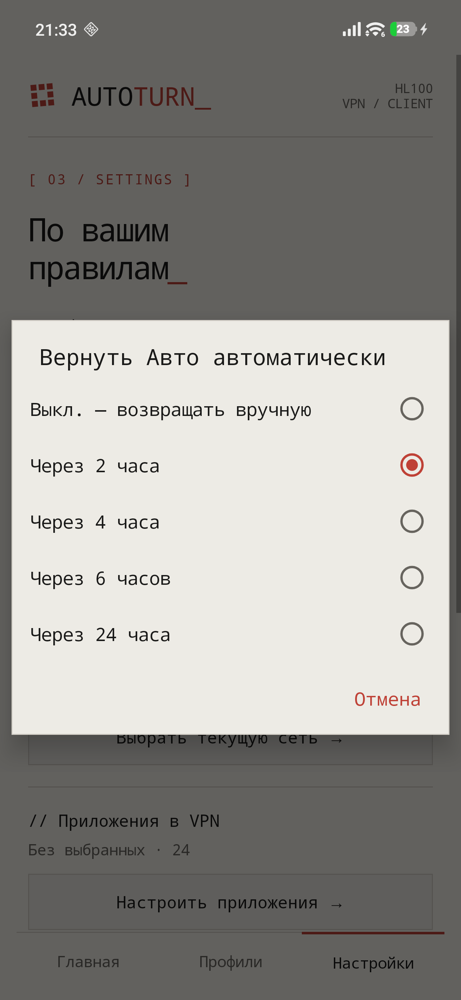

# AUTOTURN_

### Дома — напрямую. Вне дома — VPN.

Android-клиент, который автоматически включает VPN за пределами домашнего Wi-Fi и выключает его при возвращении домой. Ручное управление, несколько профилей и резервное подключение — в одном приложении.

**[Скачать APK](https://github.com/cveloy102/autoturn-vpn/releases/latest)** · **[Пошаговая инструкция](docs/usage.md)** · **[История версий](CHANGELOG.md)** · **[Сообщить об ошибке](https://github.com/cveloy102/autoturn-vpn/issues/new/choose)**

*Реальный интерфейс AutoTurn на Android. Скриншоты ниже сделаны на POCO F7 (версия 1.0.5).*

## VPN подстраивается под вашу сеть

Подключите свой VPN-профиль и отметьте домашний Wi-Fi. AutoTurn сам выберет нужное состояние туннеля в режиме **«Авто»**. Дома VPN отключён, в мобильной сети и других Wi-Fi — включён. При необходимости автоматику можно временно переопределить.

| Режим | Дома | Вне дома |
| --- | --- | --- |
| **Авто** | VPN выключен | VPN включён |
| **Включён вручную** | VPN включён | VPN включён |
| **Выключен** | VPN выключен | VPN выключен |

После ручного выбора можно установить **возврат в «Авто» через 2, 4, 6 или 24 часа** либо оставить управление полностью ручным.

## Возможности

| | |
| --- | --- |
| **Три протокола** | Импорт AmneziaWG `.conf`, VLESS + REALITY, Hysteria 2 и конфигураций Xray `.json` |
| **Несколько профилей** | Импорт, выбор, переименование и удаление; активен один туннель |
| **Резерв** | Проверка HTTPS-доступа через VPN и переход на запасной профиль при недоступности |
| **Маршрутизация приложений** | Весь трафик, только выбранные приложения или все, кроме выбранных |
| **Быстрый доступ** | Плитка в шторке Android с обозначением типа соединения |
| **Темы** | Тёмная, светлая или системная |
| **Обновления** | Проверка GitHub Releases, проверка APK перед установкой и системное подтверждение |
| **Локальные данные** | Профили и настройки хранятся на устройстве в зашифрованном виде |

## Как выглядит приложение

<table>
<tr>
<td align="center"> <b>Режимы подключения</b></td>
<td align="center"> <b>Возврат в «Авто»</b></td>
<td align="center"> <b>Светлая тема</b></td>
</tr>
</table>

## Запуск за пять шагов

1. Откройте **[последний релиз](https://github.com/cveloy102/autoturn-vpn/releases/latest)** и скачайте APK (не архив исходников).
2. Установите приложение на Android 10 или новее. Если Android запросит разрешение на установку из выбранного источника, выдайте его только для этой установки.
3. Откройте **«Профили»**, импортируйте конфигурацию вашего VPN-сервера и выберите профиль.
4. Находясь в домашней сети, укажите её в **«Настройках»**.
5. Включите **«Авто»** и подтвердите системный запрос Android на создание VPN-подключения.

**[Подробная инструкция со скриншотами, примерами и решением проблем →](docs/usage.md)**

> **Важно:** AutoTurn не предоставляет VPN-сервер, подписку или конфигурацию. Для подключения нужен собственный либо предоставленный вам профиль. Android разрешает только одно активное VPN-подключение одновременно.

## Обновление

AutoTurn автоматически проверяет наличие нового стабильного GitHub Release при открытии приложения, не чаще одного раза в 24 часа. В настройках проверку можно запустить вручную. APK скачивается средствами Android и перед установкой проверяется по SHA-256, пакету, версии и прежней подписи. Установку подтверждает пользователь в системном окне.

Текущая описанная версия — **1.0.11**. [Что изменилось](CHANGELOG.md) · [Все релизы](https://github.com/cveloy102/autoturn-vpn/releases)

## Совместимость и ограничения

- Минимальная заявленная версия — **Android 10**; реальная работа проверена на **POCO F7 с Android 16**. На других устройствах поведение может отличаться.
- Режим «Авто» зависит от корректного распознавания Wi-Fi и разрешений Android. Энергосбережение производителя способно задерживать таймеры.
- Резервное переключение зависит от доступности проверочных HTTPS-адресов. Активный туннель расходует заряд батареи.
- Работа VPN-подключения, включая доступность сайтов, зависит от настроек и состояния вашего сервера.

Подробности: [FAQ и диагностика](docs/usage.md#если-что-то-не-работает).

## Документация и разработка

**[Инструкция и FAQ](docs/usage.md)** · **[Сборка и выпуск APK](docs/DEVELOPMENT.md)** · **[Changelog](CHANGELOG.md)** · **[Как помочь проекту](CONTRIBUTING.md)** · **[Безопасность](SECURITY.md)** · **[Issues](https://github.com/cveloy102/autoturn-vpn/issues)**

Исходники Android находятся в `app/`, панель управления — в `admin-panel/`, сайт — в `site/`. Для серверных компонентов доступны отдельные инструкции: [панель](admin-panel/README.md) и [Telegram relay](admin-panel/relay/README.md). Сведения о происхождении библиотек: [Xray](app/libs/ORIGIN.md), [AmneziaWG](third_party/amneziawg-tunnel/ORIGIN.md).

**Безопасность:** не публикуйте приватные ключи, полные конфигурации VPN и адреса персональных серверов в issues или скриншотах. Отдельного файла лицензии в корне репозитория на момент подготовки документации нет; наличие публичного исходного кода само по себе не означает разрешение на его переиспользование.

---

**[AutoTurn для macOS](https://github.com/cveloy102/autoturn-macos)** — отдельное приложение с автоматизацией Wi-Fi и выборочной маршрутизацией.

