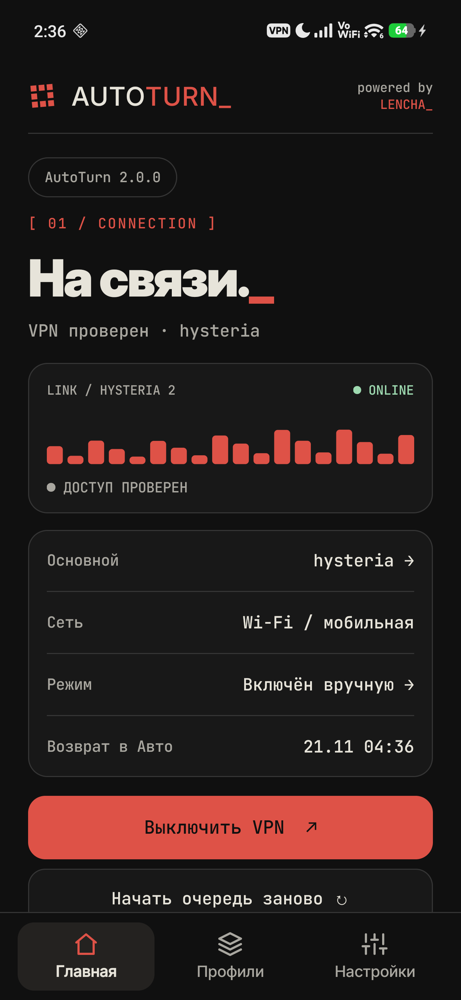
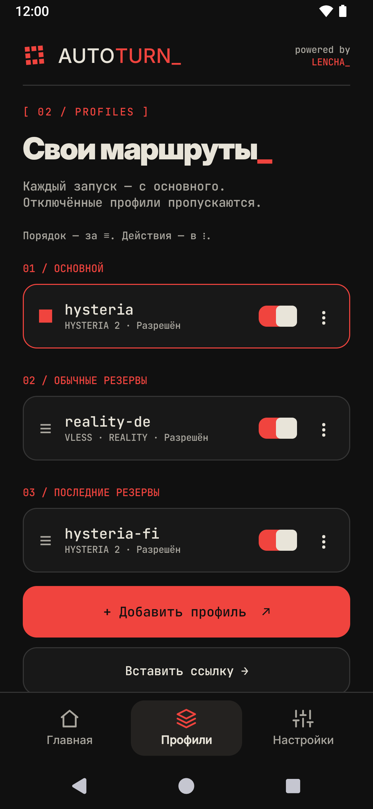
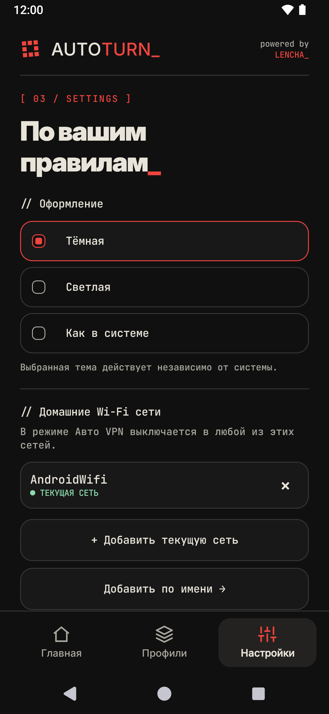

# AUTOTURN_

### Дома — напрямую. Вне дома — VPN.

Android-приложение, которое само включает VPN, когда вы уходите из дома,
и выключает его, когда возвращаетесь на домашний Wi-Fi.

**[Скачать APK](https://github.com/cveloy102/autoturn-vpn/releases/latest)** · **[Сайт](https://cveloy102.github.io/autoturn-vpn/)** · **[Инструкция](docs/usage.md)** · **[Что нового](CHANGELOG.md)** · **[Сообщить об ошибке](https://github.com/cveloy102/autoturn-vpn/issues/new/choose)**

<table><tr>
<td align="center"> Подключение</td>
<td align="center"> Профили</td>
<td align="center"> Настройки</td>
</tr></table>

*AutoTurn 2.0. Профили и имя сети на скриншотах демонстрационные.*

## Что нового в 2.0

Новый дизайн с крупным статусом и живым индикатором связи, надёжнее контроль соединения, перенос всех профилей одним файлом, ссылка не остаётся в буфере обмена. Нужен Android 12 или новее. [Подробнее о 2.0](docs/RELEASE-2.0.0.md)

## Что умеет

- **Сам переключает VPN.** Дома выключает, в любой другой сети включает. Домашних сетей может быть несколько.
- **Работает с вашими профилями:** AmneziaWG, VLESS + REALITY, Hysteria 2 и qWDTT через VK TURN.
- **Держит запасные варианты.** Проверяет, что интернет через VPN действительно работает, и при сбое переходит на следующий профиль.
- **Защищённый режим.** Пока VPN переподключается, приложения не уходят в интернет напрямую.
- **Выбирает приложения:** через VPN все, только выбранные или все, кроме выбранных.
- **Даёт ручное управление:** кнопкой в приложении или плиткой в шторке, с возвратом в Авто через 2, 4, 6 или 24 часа.
- **Переносит профили** на другой телефон одним файлом.
- **Обновляется сам** из GitHub Releases, профили при этом сохраняются.

Тёмная, светлая и системная темы.

## Как начать

1. [Скачайте APK](https://github.com/cveloy102/autoturn-vpn/releases/latest) из раздела **Assets** и установите.
2. В **Профилях** добавьте файл конфигурации или вставьте ссылку подключения.
3. Подключитесь к домашнему Wi-Fi и в **Настройках** нажмите **«+ Добавить текущую сеть»**.
4. Выберите режим **«Авто»**, разрешите местоположение **«Всегда»** (Android так даёт узнать имя Wi-Fi) и подтвердите запрос VPN.

Нужен свой VPN-сервер или выданный вам профиль: сервер и подписка в приложение не входят. Проверено на POCO F7 с Android 16 / HyperOS.

[Пошаговая инструкция со скриншотами →](docs/usage.md)

## Помощь

[Инструкция и частые вопросы](docs/usage.md#faq) · [Какие данные хранит приложение](docs/PRIVACY.md) · [Как работает защищённый режим](docs/PROTECTED-MODE.md) · [Сообщить об ошибке](https://github.com/cveloy102/autoturn-vpn/issues/new/choose)

Android держит только одно VPN-подключение одновременно. На HyperOS для работы в фоне может понадобиться разрешить автозапуск и снять ограничения батареи.

Для разработчиков: [сборка и выпуск](docs/DEVELOPMENT.md) · [участие в проекте](CONTRIBUTING.md) · [безопасность](SECURITY.md) · [сторонние компоненты](docs/THIRD_PARTY.md).

[AutoTurn для macOS](https://github.com/cveloy102/autoturn-macos)
