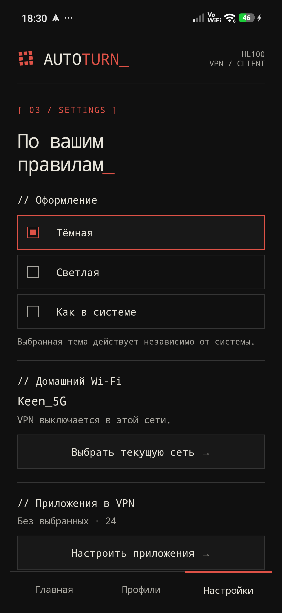
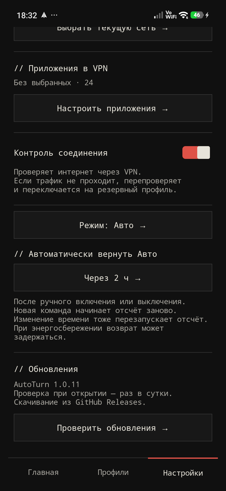

# AutoTurn для Android: инструкция

[← Обзор проекта](../README.md) · [Скачать APK](https://github.com/cveloy102/autoturn-vpn/releases/latest) · [Приватность](PRIVACY.md)

AutoTurn включает VPN вне домашнего Wi-Fi и выключает его дома. Для работы нужен профиль вашего сервера; сервер и подписка в приложение не входят.

**В этой инструкции:** [установка](#установка) · [первый запуск](#первый-запуск) · [профили](#профили) · [режимы](#режимы-и-возврат-в-авто) · [плитка](#плитка-в-шторке) · [приложения](#приложения-в-vpn) · [резерв](#резервные-профили) · [обновление](#обновление) · [FAQ](#faq).

Инструкция для AutoTurn 1.0.11. Скриншоты сняты с приложения на POCO F7.

## Установка

1. На телефоне откройте [последний релиз GitHub](https://github.com/cveloy102/autoturn-vpn/releases/latest).
2. Раскройте **Assets** и скачайте файл `AutoTurn-<версия>.apk`. Архивы **Source code** предназначены для разработчиков, `update.json` — для встроенного обновления.
3. Откройте APK. Если Android блокирует установку из этого источника, разрешите её для браузера или файлового менеджера, из которого открыли файл, затем вернитесь к установке.
4. Нажмите **«Установить»**, дождитесь завершения и откройте **AutoTurn**.

Требуется Android 10+. Для скачивания из публичного репозитория не нужен аккаунт GitHub. Другой активный VPN может отключиться при включении AutoTurn.

## Первый запуск

### 1. Добавьте и проверьте профиль

Откройте **Профили** в нижней навигации. Для файла нажмите **«+ Добавить профиль»**, для скопированной ссылки — **«Вставить ссылку»**. Форматы перечислены [ниже](#профили). Если профилей несколько, выберите нужный кнопкой **«Выбрать»**.

На **Главной** нажмите **«Включить VPN»** и подтвердите запрос Android. Откройте знакомый сайт или нужное приложение, чтобы проверить передачу трафика. Так можно проверить профиль до настройки автоматического переключения.

### 2. Запомните домашний Wi-Fi

Подключите телефон к домашней сети. Откройте **Настройки → Домашний Wi-Fi → Выбрать текущую сеть**. Разрешите **точное местоположение** и включите геолокацию телефона: Android использует это разрешение для доступа к имени Wi-Fi. AutoTurn не читает сами координаты.

*Настройки AutoTurn 1.0.11. В разделе домашней сети появится имя вашего Wi-Fi.*

AutoTurn запоминает одну сеть по **SSID** — имени Wi-Fi. При переходе между сетями 2,4 и 5 ГГц с разными именами домашней будет только выбранная. Сети с одинаковым именем считаются одной домашней сетью.

### 3. Включите Авто и разрешите работу в фоне

В строке **«Режим»** на главном экране или в настройках выберите **«Авто — дома выкл., вне дома вкл.»**. Для переключения при закрытом приложении разрешите местоположение **«Всегда»** в системных настройках приложения и вернитесь в AutoTurn. Подтвердите запрос Android на VPN, если он появится.

Android показывает уведомление работающей службы. На телефонах с ограничением фоновой работы, включая HyperOS, разрешите AutoTurn автозапуск и работу без ограничений батареи в системных настройках. Названия этих пунктов зависят от телефона.

### 4. Проверьте автоматическое переключение

1. На домашнем Wi-Fi выберите **Авто**: VPN должен быть выключен.
2. Отключите Wi-Fi, оставив мобильный интернет: дождитесь подключения VPN и проверьте открытие сайта.
3. Верните домашний Wi-Fi: дождитесь выключения VPN.
4. Повторите переход с закрытым приложением. Если переключение происходит только после открытия, проверьте фоновое местоположение, геолокацию, автозапуск и ограничения батареи.

Для работы автоматики нужны **выбранный профиль и домашняя сеть**. После ручной проверки профиля обязательно верните **Авто**, иначе ручной режим продолжит действовать.

*Так выглядит главный экран на домашнем Wi-Fi в режиме Авто.*

## Профили

| Формат | Как добавить | Поддержка |
| --- | --- | --- |
| AmneziaWG `.conf` | «+ Добавить профиль» | Нативный конфиг с `[Interface]` и `[Peer]` |
| `vless://…` | Скопировать, затем «Вставить ссылку» | VLESS + REALITY, транспорт TCP |
| `hysteria2://…` или `hy2://…` | Скопировать, затем «Вставить ссылку» | Hysteria 2; Salamander поддерживается |
| Xray `.json` | «+ Добавить профиль» | Конфигурация с поддерживаемым outbound VLESS + REALITY или Hysteria 2 |
| `.txt` с поддерживаемой ссылкой | «+ Добавить профиль» | Тот же импорт ссылки из файла |

`vpn://` из AmneziaVPN, подписки со списками ссылок и другие транспорты VLESS не импортируются. Обфускация Hysteria 2 Gecko не поддерживается. Максимальный размер импортируемого текста — 1 МиБ.

На карточке **«Имя»** переименовывает профиль, **«Удалить»** удаляет его. Одновременно активен один профиль. Удаление последнего профиля выключает VPN.

Держите исходные конфигурации в надёжном месте: очистка данных или удаление AutoTurn удалит сохранённые профили. Обновление поверх существующей установки с прежней подписью сохраняет их.

## Режимы и возврат в Авто

<table><tr>
<td></td>
<td></td>
</tr></table>

*Выбор режима и таймера в AutoTurn 1.0.11.*

| Режим | На домашнем Wi-Fi | В другой сети |
| --- | --- | --- |
| Авто | VPN выключен | VPN включён |
| Включён вручную | VPN включён | VPN включён |
| Выключен | VPN выключен | VPN выключен |

Кнопки включения и выключения задают ручной режим. Вернуть автоматику сразу можно кнопкой **«Вернуть Авто сейчас»** или выбором **«Авто»** в диалоге режима.

В **Настройках → Автоматически вернуть Авто** выберите **2, 4, 6 или 24 часа** либо **«Выкл.»**. Новая ручная команда начинает отсчёт заново; изменение срока в ручном режиме тоже перезапускает отсчёт. Выбор Авто отменяет таймер. Запланированное время видно на главном экране.

В энергосбережении Android может задержать возврат. Если в этот момент вы дома, возврат в Авто выключит VPN; вне дома — включит.

## Плитка в шторке

Раскройте быстрые настройки Android, откройте редактирование плиток и добавьте **AutoTurn**. Способ редактирования зависит от оболочки телефона.

- Нажатие вручную включает или выключает VPN независимо от домашней сети.
- Длинное нажатие открывает AutoTurn, где можно вернуть **Авто**.
- Дополнительная подпись показывает тип выбранного подключения, если оболочка её отображает. На маленьких плитках HyperOS эта подпись может быть скрыта.

Для первого подключения откройте приложение, импортируйте профиль и подтвердите системный запрос VPN.

## Приложения в VPN

Откройте **Настройки → Настроить приложения**. Выберите режим, отметьте приложения, при необходимости используйте поиск и **«Показать системные»**, затем нажмите **«Сохранить выбор»**.

*Маршрутизация приложений в AutoTurn 1.0.11.*

| Режим | Через VPN | Через обычную сеть |
| --- | --- | --- |
| Все приложения | Все приложения | — |
| Только выбранные | Отмеченные приложения | Остальные |
| Все, кроме выбранных | Остальные приложения | Отмеченные |

Пустой список **«Только выбранные»** не сохраняется. Если выбранные приложения удалены с телефона, AutoTurn не включает VPN для всех вместо них. При включённом контроле соединения AutoTurn также направляет собственные проверки через VPN; сохранённый список пользователя не меняется.

Системная настройка Android **«Блокировать соединения без VPN»** может лишить интернета приложения, которые должны идти напрямую. Она также противоречит сценарию «дома — напрямую»: в Авто домашний Wi-Fi намеренно выключает VPN. Проверьте системные настройки VPN, если приложения без туннеля не имеют интернета.

## Резервные профили

Добавьте несколько рабочих профилей и включите **Настройки → Контроль соединения**. AutoTurn проверяет реальный HTTPS через VPN. После повторных неудачных проверок переходит к следующему профилю; при одном профиле повторяет подключение. Если физической сети нет, ждёт её восстановления.

Проверочные адреса — `https://example.com/` и `https://www.wikipedia.org/`. Если оба адреса блокируются независимо от VPN, возможны лишние переподключения. При выключенном контроле состояние включённого Xray-туннеля означает запуск службы и ядра; отдельно проверяйте, что интернет работает.

## Оформление

В **Настройках → Оформление** выберите **«Тёмная»**, **«Светлая»** или **«Как в системе»**. Выбор сохраняется и применяется к диалогам и экрану приложений.

## Обновление

Откройте **Настройки → Проверить обновления**. При открытии AutoTurn также проверяет GitHub, максимум раз в 24 часа. Если версия найдена, она доступна кнопкой на главном экране, даже после выбора **«Позже»**.

*Проверка обновлений в настройках установленной версии 1.0.11.*

1. Откройте доступное обновление и начните скачивание.
2. Дождитесь загрузки и проверки APK. Скачивание может продолжаться в фоне.
3. Если Android запросит разрешение на установку из **AutoTurn**, разрешите его и вернитесь в приложение.
4. Подтвердите системную установку. После обновления откройте AutoTurn и проверьте режим.

Проверяются SHA-256, имя пакета, более новая версия и прежняя подпись. При недоступности встроенного скачивания можно вручную установить APK из [Releases](https://github.com/cveloy102/autoturn-vpn/releases/latest) поверх текущей установки. Профили сохраняются при совместимой подписи. **Не удаляйте приложение для обычного обновления.**

## FAQ

### Не определяется домашний Wi-Fi

Подключитесь к нужной сети, включите геолокацию телефона и разрешите точное местоположение AutoTurn. Для работы в фоне разрешите **«Всегда»**. Затем снова нажмите **«Выбрать текущую сеть»**. Приблизительного местоположения может быть недостаточно для чтения SSID.

### Дома VPN остаётся включённым

Проверьте режим: ручное включение имеет приоритет. Верните **Авто**, сверьте имя выбранного Wi-Fi и дождитесь обновления состояния. Другая сеть с похожим, но отличающимся именем считается внешней.

### Переключение не работает с выключенным экраном

Проверьте фоновое местоположение, геолокацию, автозапуск и ограничения батареи. На HyperOS открытие AutoTurn после обновления или перезагрузки может быть необходимо для восстановления службы. Работа на всех оболочках Android не подтверждена.

### VPN включён, но сайты не открываются

Сначала проверьте обычный интернет в режиме **«Выключен»**. Если он работает, проверьте актуальность профиля, доступность сервера, режим приложений и включите контроль соединения. Hysteria 2 требует доступности UDP. Другой VPN на устройстве может заменить подключение AutoTurn.

### Отдельное приложение осталось без интернета

Проверьте сохранённый список и режим маршрутизации. В режиме исключений отмеченные приложения идут напрямую; системная блокировка соединений без VPN может блокировать их. Сохраните список повторно после установки или удаления приложений.

### Android не устанавливает обновление

Проверьте свободное место и разрешение на установку из источника. При сообщении о конфликте подписи убедитесь, что используете официальный APK из того же канала. Самостоятельная debug-сборка подписана другим ключом и обычно не обновит официальный APK. Удаление приложения удалит его данные; сначала сохраните исходные профили.

### Какие данные хранятся и зачем разрешения

Профили, выбранные приложения и домашняя сеть хранятся локально в зашифрованных настройках с Android Keystore. Wi-Fi определяется по имени, координаты не читаются. [Подробнее о данных и сетевых запросах](PRIVACY.md).

### Какие есть ограничения

Проверено на POCO F7 с Android 16, а не на всех устройствах Android 10+. Одновременно работает один VPN. Домашняя сеть одна и определяется по SSID. Маршрутизация Android задаётся по приложениям. Поддержание Xray-туннеля при выключенном экране может увеличить расход батареи. Поддерживаются только [перечисленные форматы профилей](#профили).

### Как сообщить об ошибке

Откройте [форму ошибки](https://github.com/cveloy102/autoturn-vpn/issues/new/choose). Укажите модель телефона, версию Android и оболочки, версию AutoTurn, тип протокола, режим, шаги и ожидаемый результат. Перед отправкой скриншота скройте адрес сервера, имена личных сетей и другие личные данные. Не публикуйте конфигурацию, ключи, пароль или полную ссылку подключения.
